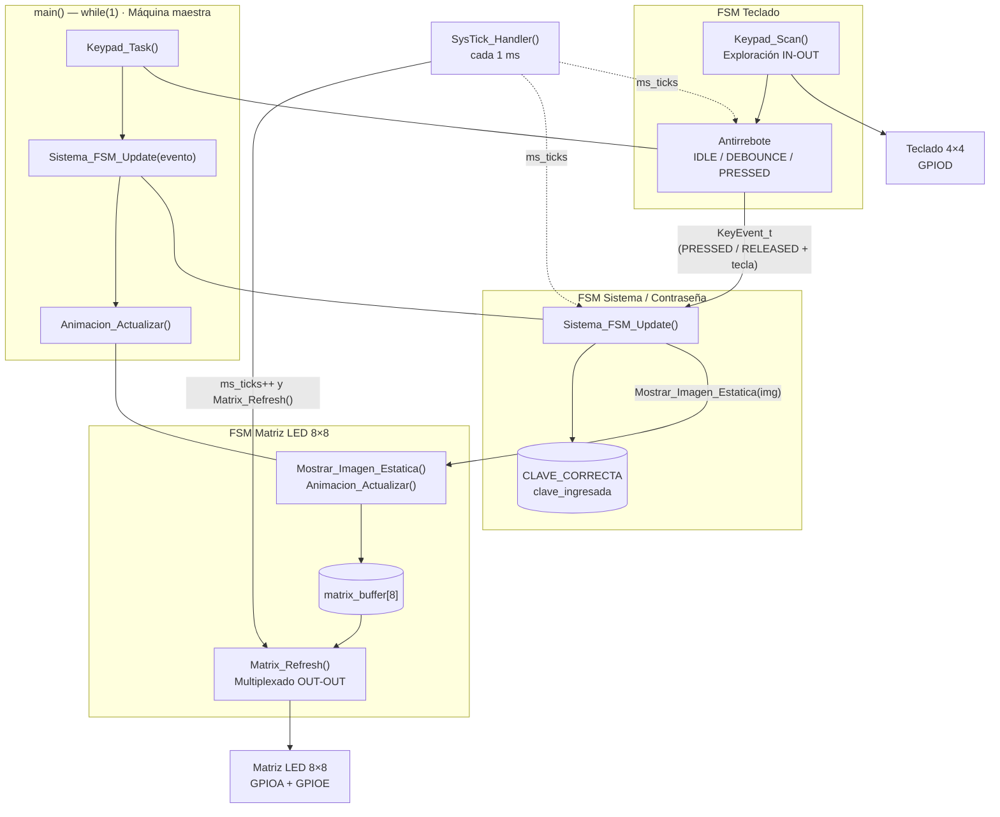
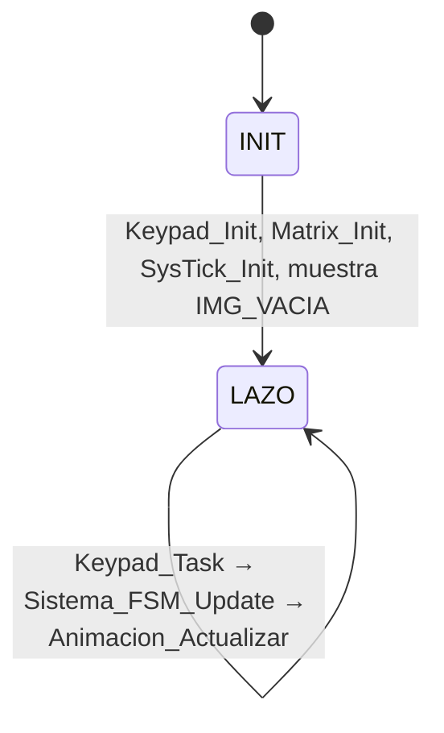
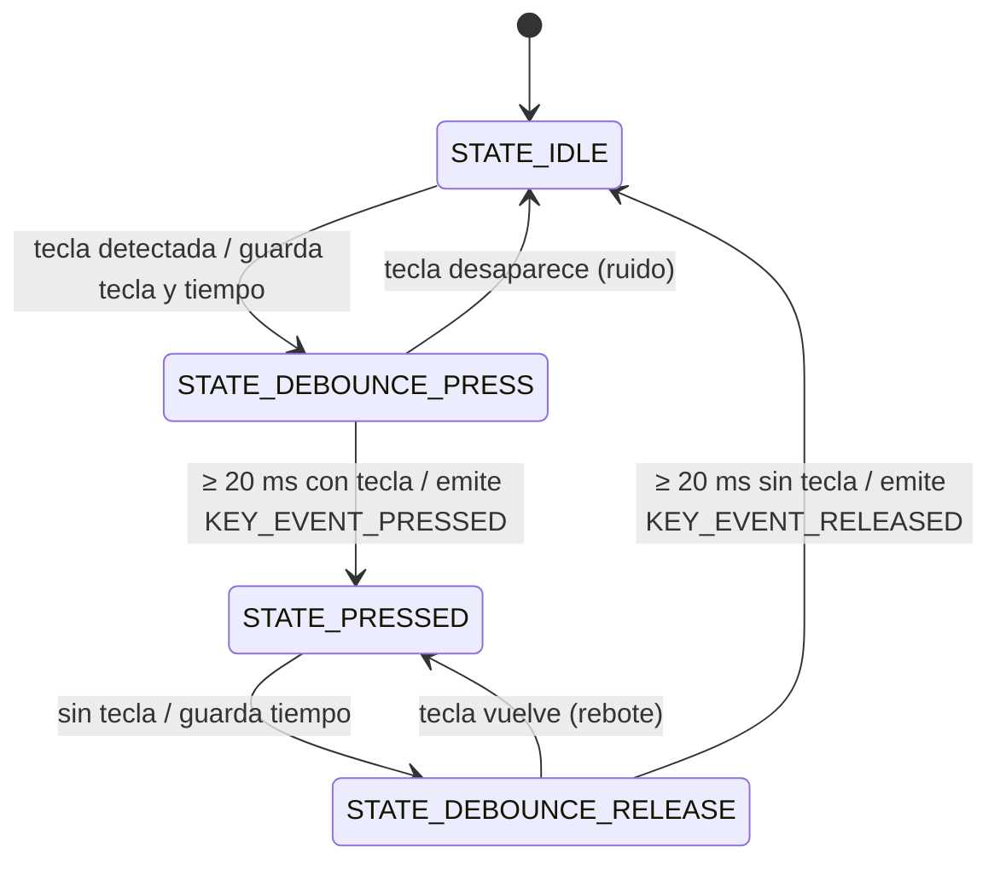
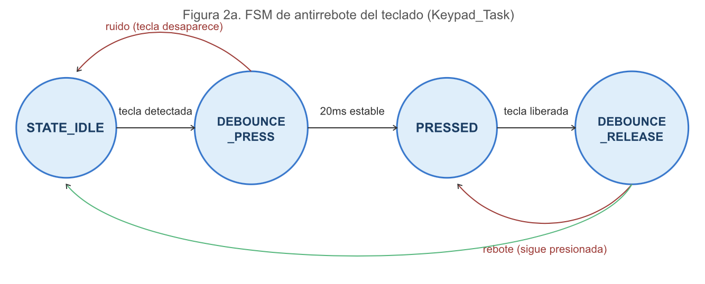
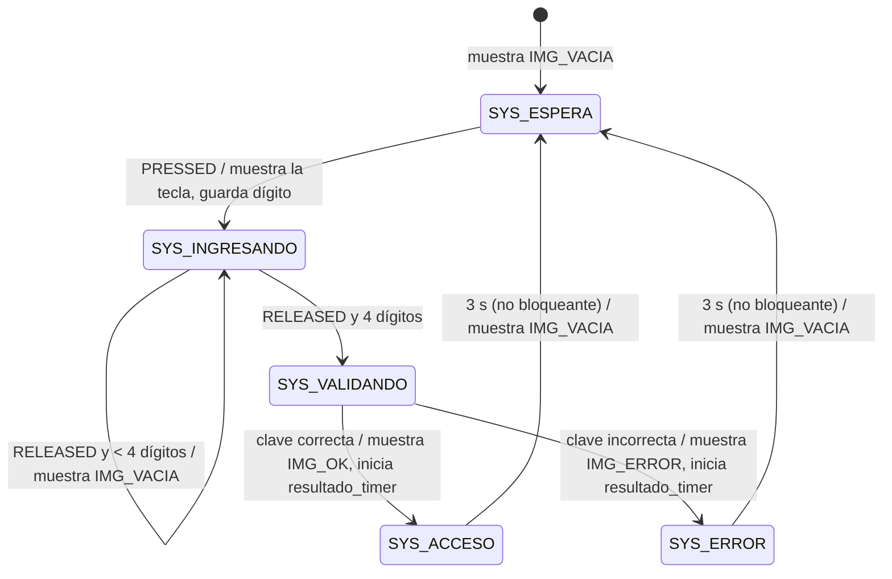
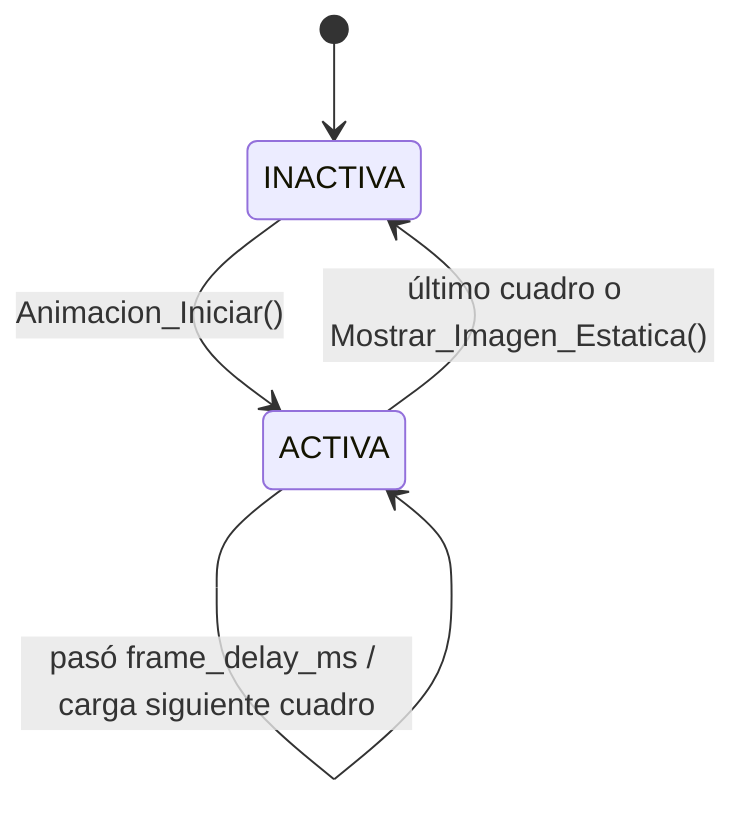
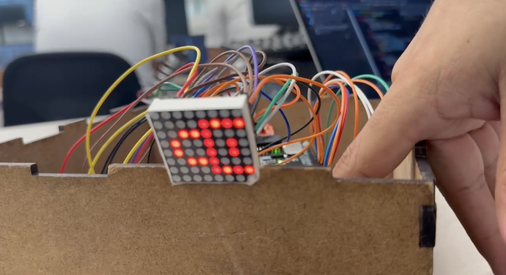
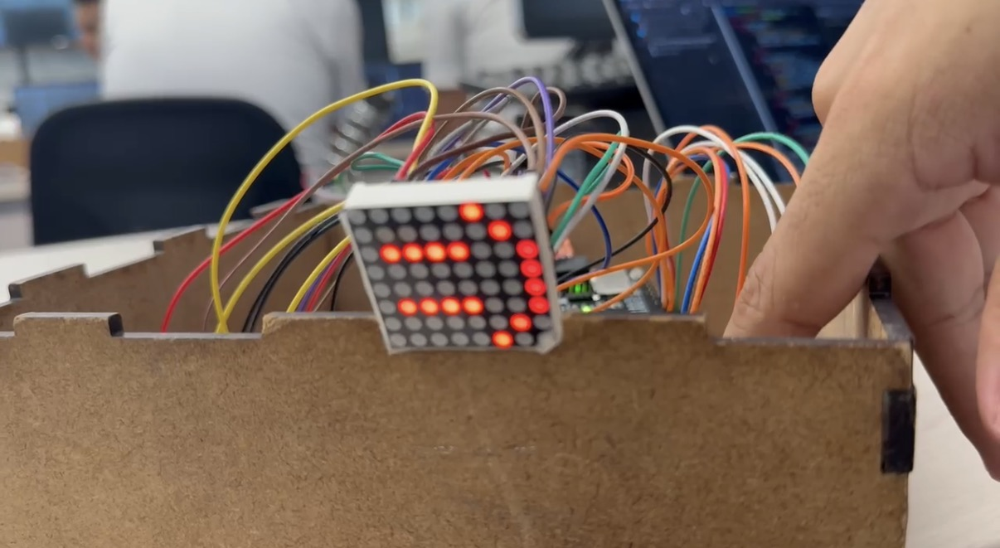
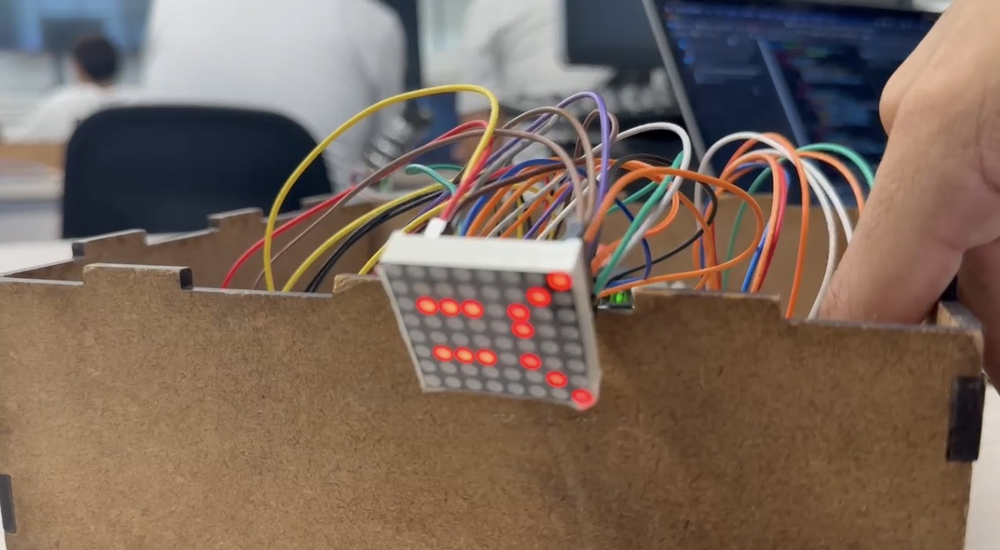

# 🔐 Reto 2 — Sistema de Acceso con Teclado Matricial y Matriz LED 8×8

**Curso:** Microprocesadores — UPB
**Microcontrolador:** STM32F407VET6
**Enfoque:** Bare-Metal (acceso directo a registros CMSIS, sin HAL), sistema concurrente cooperativo basado en máquinas de estados.

El usuario ingresa una contraseña de 4 dígitos con un teclado 4×4. Cada tecla detectada se muestra en una matriz LED 8×8. Al completar 4 dígitos, el sistema valida la clave y muestra **ACCESO** o **ERROR** durante 3 s sin bloquear, y luego vuelve a **ESPERA**.

---

## Índice

1. [Código fuente](#1-código-fuente)
2. [Diagrama de arquitectura](#2-diagrama-de-arquitectura)
3. [Diagramas de estados](#3-diagramas-de-estados)
4. [Tabla de conexión](#4-tabla-de-conexión)
5. [Demostración](#5-demostración)
6. [Decisiones de diseño](#6-decisiones-de-diseño)

---

## 1. Código fuente

Todo el programa está en **`src/main.c`**, organizado por secciones:

| Sección en `main.c` | Contenido | Funciones principales |
|---|---|---|
| Variables globales | Reloj de 1 ms y buffer de video | `ms_ticks`, `matrix_buffer[8]` |
| Configuración de la clave | Clave guardada y buffer de ingreso | `CLAVE_CORRECTA`, `clave_ingresada` |
| Máquina de estados del teclado | Estados del antirrebote | `KeypadState_t` |
| Imágenes | Mapas de bits 8×8: teclas 0-9, A-D, *, #; candado (espera), carita feliz (acceso), carita triste (error) | `IMAGES[16][8]`, `IMG_VACIA`, `IMG_OK`, `IMG_ERROR`, `Obtener_Indice_Imagen()` |
| Reproductor de animaciones | FSM de display (no bloqueante) | `Mostrar_Imagen_Estatica()`, `Animacion_Iniciar()`, `Animacion_Actualizar()` |
| Driver matriz LED 8×8 | Configuración y multiplexado OUT-OUT | `Matrix_Init()`, `Matrix_Refresh()` |
| Driver teclado 4×4 | Configuración y exploración IN-OUT | `Keypad_Init()`, `Keypad_Scan()` |
| SysTick | Base de tiempo de 1 ms | `SysTick_Init()`, `SysTick_Handler()` |
| Eventos + antirrebote | Genera eventos PRESSED / RELEASED | `KeyEvent_t`, `Keypad_Task()` |
| FSM del sistema | ESPERA / INGRESANDO / VALIDANDO / ACCESO / ERROR | `Sistema_FSM_Update()` |
| `main()` | Máquina maestra en el `while(1)` | — |

### Cómo compilar

1. Crear un proyecto en **STM32CubeIDE** para el `STM32F407VETx` sin HAL ("Empty").
2. Reemplazar `Core/Src/main.c` por `src/main.c` de este repositorio.
3. Verificar que el proyecto incluya los headers CMSIS del dispositivo (`stm32f4xx.h`) y el archivo de startup.
4. Compilar y cargar con el ST-LINK.

> SysTick se configura con `LOAD = 16000 - 1` asumiendo el **HSI de 16 MHz** que queda después del reset. Si se cambia el reloj del sistema, hay que ajustar ese valor.

**Contraseña configurada:** `0 6 0 9` (`CLAVE_CORRECTA`).

---

## 2. Diagrama de arquitectura



**Flujo de información entre máquinas:**

```
DRIVER teclado ──> EVENTO (KeyEvent_t) ──> LÓGICA (Sistema_FSM_Update) ──> DISPLAY (matrix_buffer) ──> ISR SysTick
```

La FSM del teclado no conoce la clave ni la matriz: solo devuelve un `KeyEvent_t`. La FSM del sistema solo recibe ese evento y actúa sobre la matriz a través de `Mostrar_Imagen_Estatica()`.

---

## 3. Diagramas de estados

### 3.1 Máquina maestra (`main`)



Ninguna de las tres funciones del lazo se bloquea: cada una revisa su estado, actúa si corresponde y retorna.

### 3.2 FSM de antirrebote (`Keypad_Task`)



`KEY_EVENT_PRESSED` se emite **una sola vez por pulsación**. Mientras la tecla se mantiene, la FSM permanece en `STATE_PRESSED` sin generar eventos.



*Diagrama de la FSM de antirrebote. La flecha verde es la liberación confirmada (≥ 20 ms sin tecla), que devuelve el teclado a `STATE_IDLE` y emite `KEY_EVENT_RELEASED`.*

### 3.3 FSM del sistema / contraseña (`Sistema_FSM_Update`)



Solo los dígitos `0–9` cuentan para la clave. Las teclas `A–D`, `*` y `#` se muestran en la matriz pero no se registran.

### 3.4 FSM de display (`Animacion_t`)



En `INACTIVA`, la matriz mantiene la última imagen cargada en `matrix_buffer`, porque la ISR la sigue dibujando.

---

## 4. Tabla de conexión

| Dispositivo | Señales | GPIO utilizado | Configuración |
|---|---|---|---|
| Teclado | F0–F3 (filas) | **PD0–PD3** | Salida; fila activa en LOW |
| Teclado | C0–C3 (columnas) | **PD4–PD7** | Entrada con pull-up; LOW = tecla presionada |
| Matriz | F0–F7 (filas, cátodo) | **PA0–PA7** | Salida; fila activa en LOW, 330 Ω en serie |
| Matriz | C0–C7 (columnas, ánodo) | **PE8–PE15** | Salida; columna encendida en HIGH |

### Detalle de la matriz (pin físico del módulo → GPIO)

| Fila | Pin físico | GPIO | | Columna | Pin físico | GPIO |
|---|---|---|---|---|---|---|
| F0 (fila 1) | 9  | PA0 | | C0 (col 1) | 13 | PE8  |
| F1 (fila 2) | 14 | PA1 | | C1 (col 2) | 3  | PE9  |
| F2 (fila 3) | 8  | PA2 | | C2 (col 3) | 4  | PE10 |
| F3 (fila 4) | 12 | PA3 | | C3 (col 4) | 10 | PE11 |
| F4 (fila 5) | 1  | PA4 | | C4 (col 5) | 6  | PE12 |
| F5 (fila 6) | 7  | PA5 | | C5 (col 6) | 11 | PE13 |
| F6 (fila 7) | 2  | PA6 | | C6 (col 7) | 15 | PE14 |
| F7 (fila 8) | 5  | PA7 | | C7 (col 8) | 16 | PE15 |

### Distribución del teclado

|      | C0 (PD4) | C1 (PD5) | C2 (PD6) | C3 (PD7) |
|---|---|---|---|---|
| **F0 (PD0)** | 1 | 2 | 3 | A |
| **F1 (PD1)** | 4 | 5 | 6 | B |
| **F2 (PD2)** | 7 | 8 | 9 | C |
| **F3 (PD3)** | * | 0 | # | D |

---

## 5. Demostración

### Evidencia fotográfica

Montaje: STM32F407VET6 dentro de la caja, matriz LED 8×8 al frente y teclado 4×4 a la derecha. En el montaje, la matriz quedó girada 90°, por eso las figuras se ven de lado.

| ESPERA — candado | ACCESO — carita feliz | ERROR — carita triste |
|---|---|---|
|  |  |  |
| `IMG_VACIA`: sistema listo, ninguna tecla presionada | `IMG_OK`: clave `0609` correcta, visible 3 s | `IMG_ERROR`: clave incorrecta, visible 3 s |

### Puntos a evidenciar

- [ ] Detección correcta de las teclas
- [ ] Funcionamiento del antirrebote
- [ ] Multiplexación del teclado
- [ ] Multiplexación de la matriz LED
- [ ] Ingreso de cuatro dígitos
- [ ] Validación de contraseña
- [ ] Indicación de acceso correcto
- [ ] Indicación de error
- [ ] Temporización de aproximadamente 3 segundos
- [ ] Retorno automático al estado de espera

### Condiciones de prueba

| Prueba | Resultado esperado | Cómo se cumple | ✔ |
|---|---|---|---|
| Encender el sistema | Aparece imagen de espera | `main()` muestra `IMG_VACIA` antes del lazo | ☐ |
| Presionar una tecla | Se detecta una única pulsación | `KEY_EVENT_PRESSED` solo en la transición `DEBOUNCE_PRESS → PRESSED` | ☐ |
| Mantener una tecla presionada | No se generan múltiples pulsaciones | `STATE_PRESSED` no emite eventos | ☐ |
| Liberar una tecla | El sistema vuelve a aceptar nuevas pulsaciones | `DEBOUNCE_RELEASE → IDLE` tras 20 ms | ☐ |
| Ingresar 4 dígitos | Se inicia validación | `clave_index >= CLAVE_LONGITUD` → `SYS_VALIDANDO` | ☐ |
| Contraseña correcta (`0609`) | Aparece imagen de acceso | `IMG_OK` | ☐ |
| Contraseña incorrecta | Aparece imagen de error | `IMG_ERROR` | ☐ |
| Esperar 3 s | Se elimina la imagen de resultado | `(ms_ticks - resultado_timer) >= RESULTADO_DURACION_MS` | ☐ |
| Nueva contraseña | El sistema permite un nuevo intento | `clave_index = 0` al validar | ☐ |
| Funcionamiento continuo | La matriz no presenta parpadeo perceptible | SysTick refresca 1 fila/ms → 125 cuadros/s | ☐ |

---

## 6. Decisiones de diseño

- **Multiplexado de la matriz dentro de SysTick (1 ms).** El refresco es periódico y no depende de cuánto tarde el `while(1)`. Con 8 filas se obtienen 125 cuadros por segundo, sin parpadeo. Antes de cambiar de fila se apagan todas las filas y columnas para evitar imágenes fantasma.
- **Buffer de video intermedio.** La lógica nunca toca los GPIO de la matriz: escribe `matrix_buffer[8]` y la ISR lo dibuja. Así el display queda desacoplado de la aplicación.
- **Comunicación por eventos.** El teclado produce `KeyEvent_t {tipo, tecla}` y la FSM del sistema decide qué hacer con él.
- **Temporización sin bloqueo.** El antirrebote (20 ms) y el resultado (3 s) se miden restando `ms_ticks` a una marca de tiempo guardada. La resta en `uint32_t` sigue siendo correcta cuando el contador se desborda.
- **Almacenamiento de la clave.** `CLAVE_CORRECTA` es `const`, así que el enlazador la ubica en FLASH (`.rodata`): no ocupa RAM y no se puede modificar en ejecución. `clave_ingresada` vive en RAM.
- **Escritura atómica con BSRR.** Todos los cambios de pines usan `BSRR`, que pone en alto o en bajo bits específicos en una sola escritura, sin lectura-modificación-escritura. Esto es seguro aunque la ISR interrumpa al programa principal.
- **Pines consecutivos.** Las columnas en PE8–PE15 permiten escribir el byte de la fila de una sola vez (`datos << 8`), sin repartir bits entre puertos.
